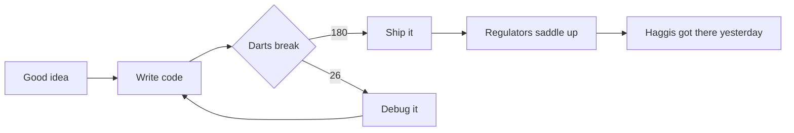

# The Regulator's field manual

<kbd>COWBOY</kbd> + <kbd>CODE</kbd> + <kbd>DARTS</kbd>

Fort Sumner software. We ship. The haggis shipped yesterday.

 

<table>
  <tr>
    <td width="58%" align="center" valign="middle">
      
    </td>
    <td width="42%" valign="top">
      <h2>billythekid</h2>
      
<strong>Class</strong> <code>cowboy-programmer</code>

      
<strong>Companion</strong> <code>one extremely mobile haggis</code>

      
<strong>Current quest</strong> Change the world. The world has requested changes.

      

      

        <kbd>⌘</kbd> <kbd>↵</kbd> ship it, then look surprised 
        <kbd>⌘</kbd> <kbd>Z</kbd> call the last ten minutes research 
        <kbd>180</kbd> a rumour this office encourages
      

    </td>
  </tr>
</table>

> [!NOTE]
> Five tentacles cover the rota. One has the laptop, one has the darts, and the other three are in a meeting with a tartan haggis that already merged itself.

## Loadout

| Slot | Equipment | Condition | Notes |
| :--- | :--- | :---: | ---: |
| Head | Battered cowboy hat | `FIELD TESTED` | +10 authority, invalid indoors |
| Eyes | Rectangular glasses | `REQUIRED` | +20 perception, mostly of the 1 |
| Left hand-ish | Steel-tip dart | `ARMED` | 23g, and an alibi |
| Right hand-ish | Terminal | `CONNECTED` | `git status`, emotionally unavailable |
| Ground support | Tartan haggis | `UNCONTAINED` | on call, unfortunately |

## Match board

<table>
  <thead>
    <tr>
      <th align="left">Round</th>
      <th align="center">Target</th>
      <th align="right">Result</th>
      <th align="left">Official explanation</th>
    </tr>
  </thead>
  <tbody>
    <tr>
      <td><code>01</code></td>
      <td align="center"><strong>20</strong></td>
      <td align="right">60</td>
      <td>Skill. Also luck. Mostly skill. Fine: luck.</td>
    </tr>
    <tr>
      <td><code>02</code></td>
      <td align="center"><strong>BULL</strong></td>
      <td align="right">50</td>
      <td>The bull started it.</td>
    </tr>
    <tr>
      <td><code>03</code></td>
      <td align="center"><strong>1</strong></td>
      <td align="right">1</td>
      <td>A dependency resolved into the wrong integer.</td>
    </tr>
    <tr>
      <td colspan="2"><strong>Total after three darts</strong></td>
      <td align="right"><strong>111</strong></td>
      <td>No averages were harmed. One ego filed a ticket.</td>
    </tr>
  </tbody>
</table>

## Release pipeline

> [!TIP]
> Build red? Stare at the dartboard. Causation hates eye contact. The dartboard will not blink first.

  
<strong>Open the saddlebag</strong> (contents may have already left)

   
  <table>
    <tr>
      <th align="left">Inventory</th>
      <th align="center">Qty</th>
      <th align="left">Purpose</th>
    </tr>
    <tr>
      <td><code>git reflog</code></td>
      <td align="center">∞</td>
      <td>Time travel. Return trip not included.</td>
    </tr>
    <tr>
      <td>Rubber duck</td>
      <td align="center">1</td>
      <td>Senior review. Silent. Correct. Infuriating.</td>
    </tr>
    <tr>
      <td>Backup flight</td>
      <td align="center">3</td>
      <td>The carpet remains champion, and rude about it.</td>
    </tr>
    <tr>
      <td>Haggis treats</td>
      <td align="center">0</td>
      <td>This is the incident.</td>
    </tr>
  </table>

  

    
There is a smaller pocket inside the saddlebag

  - [x] Hat
  - [x] Darts
  - [x] Laptop
  - [ ] Permission to change the world
  - [ ] A slower haggis

  

## Palette

Official colours. If they clash with the tartan, the tartan wins.

| Western leather | Neckerchief | Terminal | Background |
| :---: | :---: | :---: | :---: |
| `#7A431D` | `#9E3925` | `#66E58A` | `#BDEFF2` |

---

Built from plain GitHub Flavored Markdown, a little permitted HTML, and the confidence of someone who hit a bull once and has not let it go.[^gfm]

**[Return to the profile](./README.md)**

[^gfm]: GitHub renders tables, alerts, collapsed sections, footnotes, task lists, syntax highlighting, diagrams, and a safe subset of HTML directly in Markdown files. The haggis renders nothing. It has already left the building.
